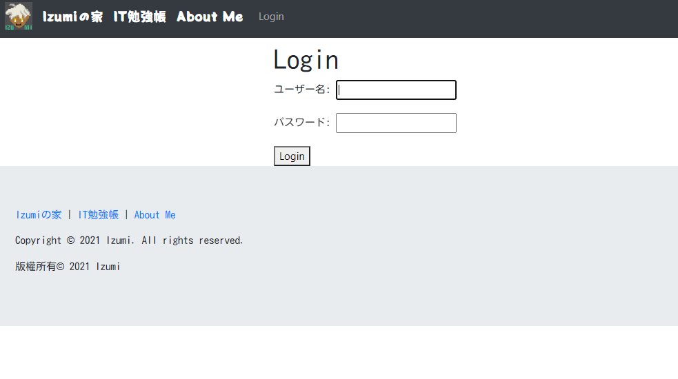
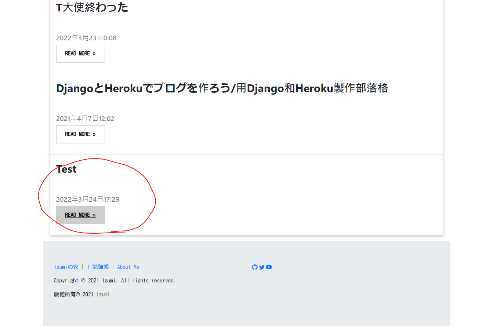

# BlogStar｜Izumi の個人 Blog

這個 Repository 保存的是我在 2021 年左右開始製作的 Django 個人部落格。

一開始是跟著日本線上教學學習 Django 與基本 CRUD，後來逐漸把練習延伸成自己的網站。我開始思考個人 Blog 需要哪些頁面、如何保存文章、如何登入管理內容，以及怎麼讓網站呈現出自己的風格。

這個專案對我而言，是第一個從教學練習出發、再由自己延伸功能與架構的網站作品。現在整理它的目的，是保存當時的成果與開發歷程，並讓它有機會重新成為一個可以自己使用的個人 Blog。

## 網站原本包含的內容

- 個人首頁與自我介紹
- 技術文章列表與文章詳細頁
- Django Model 與 ORM 文章資料存取
- Django Admin 文章管理
- Django Authentication 登入流程
- TinyMCE 富文字編輯器與 HTML 文章內容
- Bootstrap、W3.CSS 等前端版面資源

> 編輯器使用 TinyMCE，並非 Markdown 編輯器。本專案沒有完成 Markdown 功能。

## Repository 內的其他歷史檔案

除了 Django Blog，Repository 後續也保存了兩份獨立 Notebook：

- weather_alert.ipynb：公開災害預警 JSON Feed 的擷取與篩選實驗。
- 日本語VL-T5推論.ipynb：使用日文 VL-T5 與 Faster R-CNN 預訓練模型進行視覺語言推論的實驗。

這兩份 Notebook 不是 Blog 網站的功能，也不代表自行訓練了相關模型。

## 技術

- Python、Django 2.2.x
- Django ORM、Django Admin、Authentication
- TinyMCE、HTML、CSS、Bootstrap、W3.CSS
- MySQL（main 分支目前設定的資料庫）
- Heroku、Gunicorn、WhiteNoise（歷史部署分支）
- Requests、JSON、PyTorch、Transformers（獨立 Notebook 實驗）

## 分支說明

| Branch | 用途 |
|---|---|
| main | 主要保存版本，包含網站截圖與後續上傳的實驗檔案 |
| master | 早期 Django 網站版本 |
| Herokubranch | 當年研究 Heroku 部署及前台 CRUD 的版本 |
| docs/portfolio-retrospective | 專案歷史、技術回顧與保存文件 |

這些程式分支的起始歷史並非一般共同祖先分岔關係，請參閱回顧文件，不要在未比較內容前直接合併或刪除。

## 目前狀態

這是歷史專案保存與局部修復工作，並非已重新部署的線上服務。

- 尚未完成舊環境重現與完整測試。
- main 的前台新增／編輯文章流程並未完整啟用。
- Repository 內有 SQLite 資料庫檔案，但尚未確認其中的資料內容。
- 舊版部署設定與依賴需要重新評估。
- Git 歷史可能仍保留舊的敏感設定，現行程式中的佔位值不代表歷史風險已完全解除。

## 歷史畫面

## 專案回顧

完整的開發歷程、分支差異、技術架構、資料庫注意事項與修復方向，請參閱 [PROJECT_RETROSPECTIVE.md](PROJECT_RETROSPECTIVE.md)。
