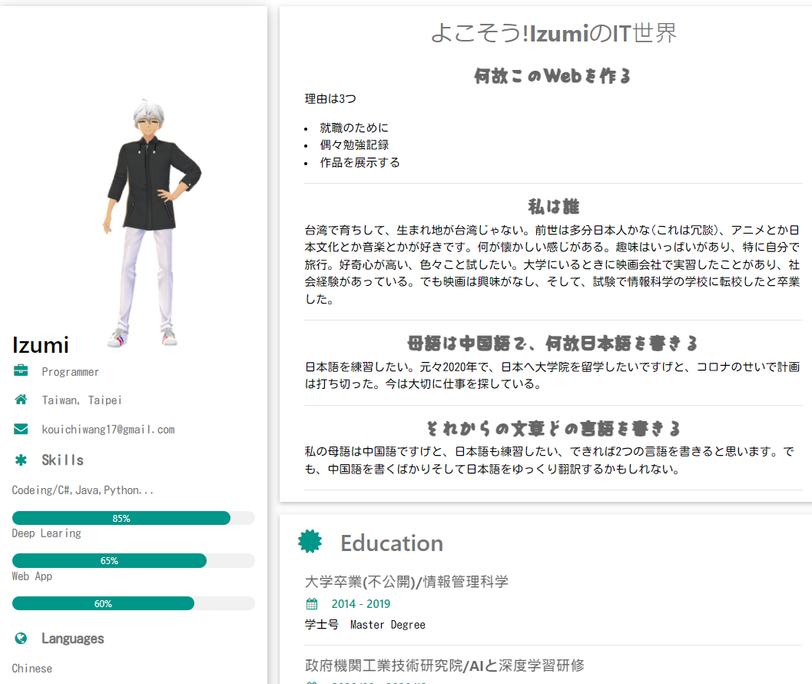
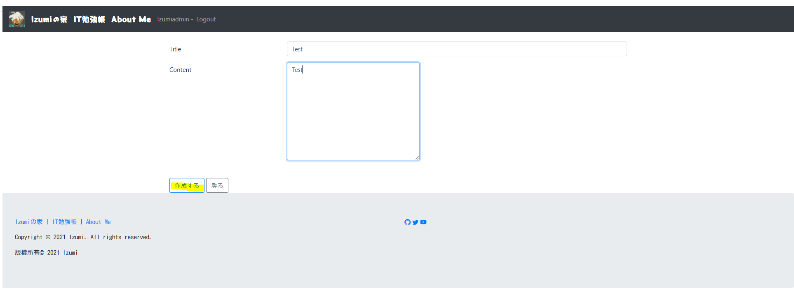

# BlogStar｜Django 個人部落格與技術作品展示

本 Repository 保存一個以 Django 建置的個人部落格／作品展示網站，以及兩份獨立的 AI／資料處理 Notebook 實驗。

## 專案內容

### Django 部落格網站

- 首頁與個人介紹頁。
- 技術文章列表與文章詳細頁。
- 使用 Django Model 儲存文章標題、HTML 內容與發佈時間。
- 使用 Django Admin 管理文章資料。
- 使用 Django 內建 authentication routes 提供登入流程。
- 文章內容欄位使用 TinyMCE HTML editor。

### 附屬 Notebook 實驗

- `weather_alert.ipynb`：讀取災害預警 JSON feed，嘗試篩選屏東或恆春相關的低溫及降雨訊息。
- `日本語VL-T5推論.ipynb`：載入既有日文 VL-T5 與 Faster R-CNN 預訓練模型，進行圖片問答、圖文匹配、視覺定位及區域描述推論。

這兩份 Notebook 是獨立實驗紀錄，不是 Django 網站的內建功能，也不代表自行訓練了 VL-T5 模型。

## 技術

- Python、Django 2.2
- Django ORM、Django Admin、Authentication
- TinyMCE、HTML、CSS、Bootstrap
- Python Requests、JSON
- PyTorch、Transformers、VL-T5、Faster R-CNN（Notebook 推論實驗）
- Heroku、Gunicorn、WhiteNoise（歷史部署設定分支）

## 重要說明

- 本 Repository 依歷史程式碼整理，未重新安裝舊版相依套件或重新部署。
- 部落格文章管理可透過 Django Admin；一般使用者介面的新增／編輯路由並未完整接通，部分表單與 view 為未完成或停用狀態。
- 刪除文章的 view 目前透過 GET 路由執行，未見獨立的 POST 確認流程；不應視為符合現代安全實務的完整 CRUD。
- `settings.py` 的 Django `SECRET_KEY` 已由原始字串改為 `SECRET_KEY` 佔位值。若要重新執行，必須先設定安全的環境變數並調整設定讀取方式。
- Git 歷史未重寫，舊 commit 仍可能保留原始 secret。
- Repository 中仍追蹤本機 SQLite 資料庫及大量 `node_modules`／舊虛擬環境檔案；本次沒有刪除或改動這些歷史檔案。

## 技術回顧

更多實作證據、Notebook 範圍及技術限制，請參閱 [PROJECT_RETROSPECTIVE.md](PROJECT_RETROSPECTIVE.md)。

## 歷史畫面

